<picture></picture>

  <picture></picture>

### ❁ ❁ <picture></picture>

➺ Estudiante de Ingeniería de sistemas, aprendiendo desarrollo de software, inteligencia artificial y análisis de datos.

- 🔭 Ahora mismo aprendiendo
  
### 🛠️ Tecnologías que más uso

  <picture></picture>

  <picture></picture>
  <picture></picture>
  <picture></picture>
  <picture></picture>
  <picture></picture>
  <picture></picture>

### 📊 Estadísticas

  <picture></picture>
  <picture></picture>

  <picture></picture>

### 🧜‍♀️ Mis contribuciones

  <picture></picture>

<picture></picture>
